<p align="center">
  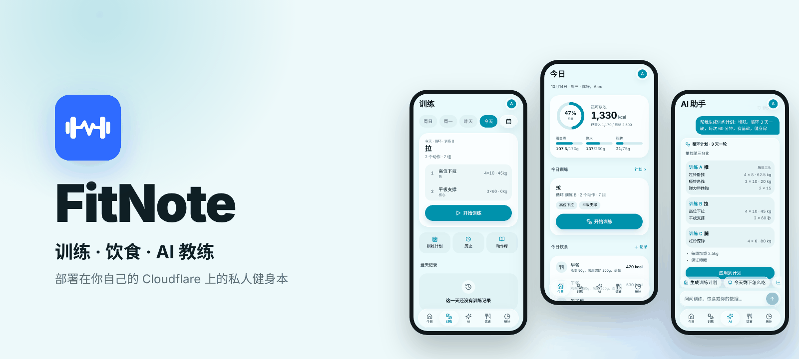
</p>

<p align="center">
  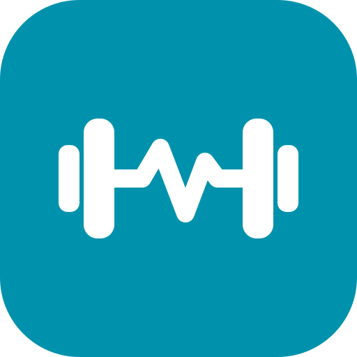<br>
  <b>FitNote</b> · 训练、饮食和 AI 教练，装进一个属于你自己的手机网页
</p>

<p align="center">
  
  
  
  
  
  
</p>

FitNote 是一个为手机浏览器设计的私人健身记录本。它部署在**你自己的 Cloudflare 账号**上，数据存在你自己的 D1 数据库里；Fork 之后跟随上游更新，也不会覆盖你的数据和设置。

## ✨ 功能

| | |
| --- | --- |
| 🏋️ **训练** | 每一组一键记录，显示上次成绩和建议重量，破纪录即时提醒；组间休息计时，结束振动提醒 |
| 🔥 **热身组与 RPE** | 热身组单独标记，不计入组数、容量和纪录；每组可记 RPE（6–10） |
| 🔁 **计划** | 按星期安排，或 A/B/C 循环分化（一轮 2–6 天，练完自动轮到下一天） |
| 🍱 **饮食** | 拍照后由视觉模型估算热量和三大营养素；常吃的饭一键再记，可复制到其他日期 |
| ✨ **AI 助手** | 能读取你的全部记录：直接对话、生成训练计划（预览后再应用）、今天剩下怎么吃、月度复盘 |
| 📈 **进度** | 每个动作的重量曲线和估算 1RM、体重 7 天平均、营养趋势、训练频率 |
| 📴 **离线** | 断网时训练、饮食、体重、饮水先存在手机上，联网后自动同步 |
| 🔒 **隐私** | 可设访问密码；AI 密钥只存在你的 D1 中，不会返回浏览器，也不进入导出的备份 |
| 🌗 **外观** | 浅色 / 深色自动切换，为单手操作设计的大按钮和步进器 |

## 📱 截图

<table>
  <tr>
    <td align="center">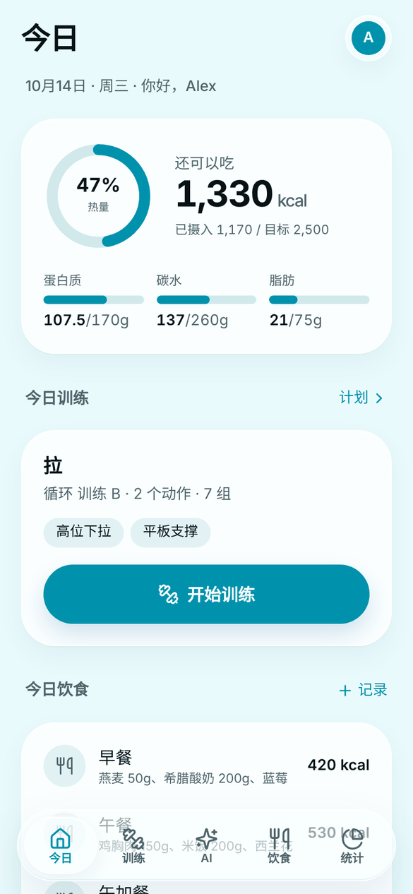<br><sub>今日概览</sub></td>
    <td align="center">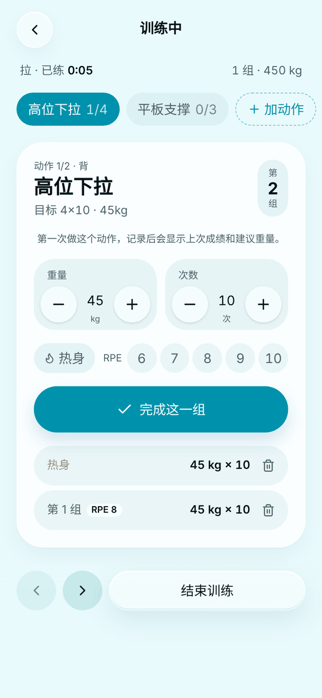<br><sub>训练中 · 热身组与 RPE</sub></td>
    <td align="center">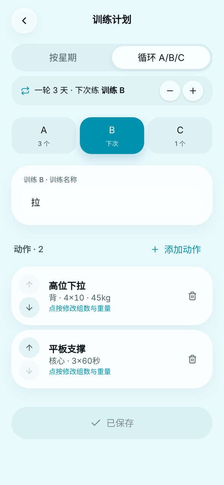<br><sub>A/B/C 循环计划</sub></td>
  </tr>
  <tr>
    <td align="center">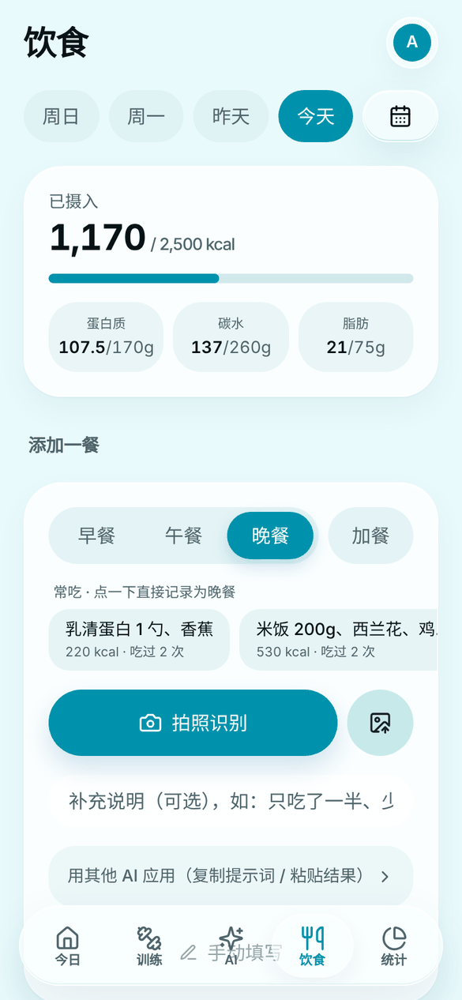<br><sub>饮食记录 · 拍照识别</sub></td>
    <td align="center">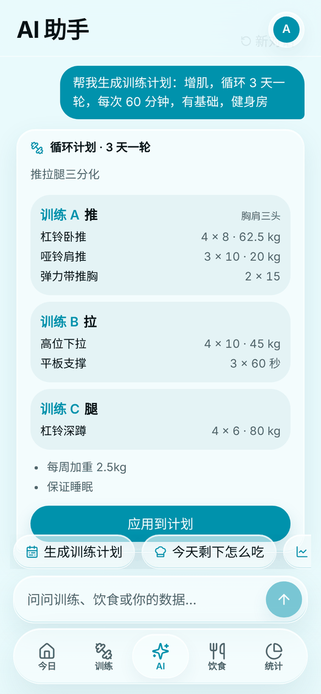<br><sub>AI 助手 · 生成训练计划</sub></td>
    <td align="center">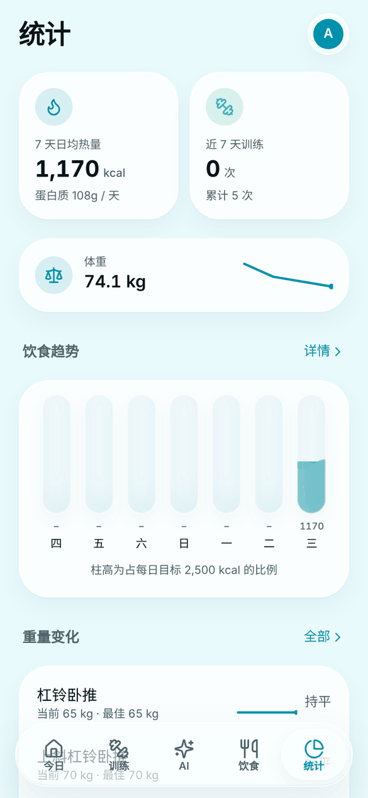<br><sub>统计</sub></td>
  </tr>
  <tr>
    <td align="center">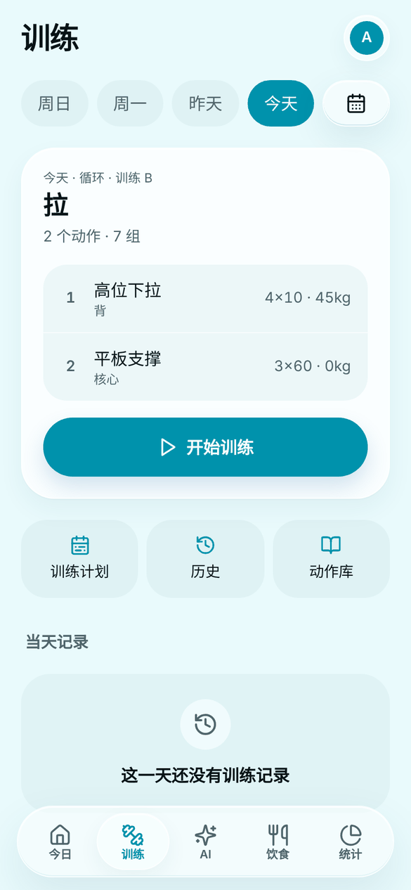<br><sub>今日训练</sub></td>
    <td align="center">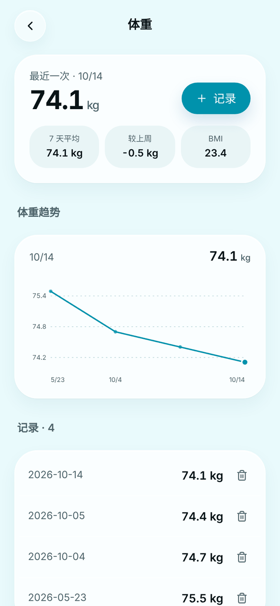<br><sub>体重趋势</sub></td>
    <td align="center">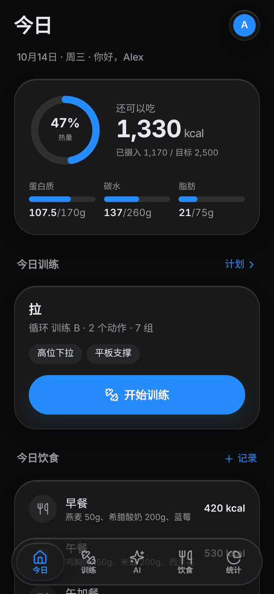<br><sub>深色模式</sub></td>
  </tr>
</table>

<sub>截图中为示例数据。</sub>

## 🧱 技术栈

- **前端**：React 19、TypeScript、Vite 6、Tailwind CSS 4、React Router 7、lucide-react，PWA（Service Worker + Manifest）
- **后端**：Cloudflare Workers + D1（SQLite），Drizzle 生成迁移，运行时自动增量建表
- **AI**：兼容 OpenAI 接口的服务商（DeepSeek、通义千问、智谱、豆包、OpenAI、Gemini、硅基流动、OpenRouter 等）以及 Anthropic 接口

```
src/       前端页面与组件
worker/    Worker API、数据库结构与迁移、AI 调用
shared/    前后端共用的 AI 服务商预设
public/    图标、Manifest、Service Worker
scripts/   本地开发启动脚本
```

## 🚀 部署与数据持久化

**你的数据永远只在你自己 Cloudflare 账号下的 D1 数据库里，更新代码、重新部署都不会覆盖它。**

这个仓库刻意不包含任何账号相关的 ID 或个人设置：

| 内容 | 存放位置 | 更新/重新部署时 |
| --- | --- | --- |
| 训练、饮食、计划、身体数据、营养目标、提醒、时区、AI 设置 | 你的 D1 数据库 `fitnote` | 保留 |
| 访问密码 `APP_PASSCODE` | Cloudflare 机密（Secret） | 保留 |
| 其他变量（如 `DEFAULT_TIMEZONE`） | Cloudflare 控制台变量 | 保留（`keep_vars = true`） |
| 外观（深色/浅色）、AI 对话记录 | 当前设备浏览器 | 保留 |

### 第一次部署（Fork 后）

方式 A：Cloudflare 控制台（推荐，手机上也能完成）

1. Fork 本仓库。
2. Cloudflare 控制台 → Workers & Pages → 创建 → 导入 Git 仓库，选择你的 fork。
3. 构建命令：`npm run build`；部署命令：`npx wrangler deploy`。
4. 部署时会自动创建名为 `fitnote` 的 D1 数据库并绑定；第一次打开网页时表结构会自动建立。

方式 B：本地命令行

```bash
npm ci
npx wrangler login
npm run deploy
```

### 之后的更新

在 GitHub 上点 **Sync fork**（或 `git pull upstream main`）即可。Cloudflare 会重新构建部署：

- 数据库按绑定名/数据库名找到原来那个，**不会新建、不会清空**；
- 新版本需要的表和字段会在第一次请求时自动、增量地补上，不会改动已有记录；
- 不需要手动执行任何迁移命令。

> 已经部署过旧版本？无需任何操作。旧版 `wrangler.toml` 里的 `database_id` 已移除，部署时 wrangler 会沿用这个 Worker 已绑定的数据库。

### 开启访问密码（强烈建议）

默认任何知道网址的人都能访问。到 Worker → 设置 → 变量和机密 → 添加 **Secret**：
名称 `APP_PASSCODE`，值为你的密码。之后每台设备第一次打开时输入一次即可。

可选：添加普通变量 `DEFAULT_TIMEZONE`（例如 `Asia/Shanghai`），用于全新数据库的默认时区；
也可以在 App 的「我的 → 身体数据 → 时区」里修改。

## 🤖 AI 功能配置

AI 功能是可选的，不配置也能正常使用其他所有功能。

在 App 内「我的 → AI 识别」选择服务商（或自定义 OpenAI 兼容 / Anthropic 接口），填写模型名和 API 密钥，点「测试」确认即可。直接输入模型名（如 `deepseek-v4-flash`、`qwen3-vl-plus`）会自动匹配服务商。服务商预设在 `shared/ai-providers.ts`，可自行增改。

- **拍照识别**：饮食页点「拍照识别」打开相机，照片连同提示词发给视觉模型，解析出热量和三大营养素，核对后保存。需要支持图片的模型。
- **AI 助手**：底部 Dock 中间的「AI」。内置三个工具：
  - **生成训练计划**：选目标、按星期或循环、每次时长、水平和器械，生成后先预览，点「应用到计划」才会覆盖对应训练日（训练历史不受影响）；
  - **今天剩下怎么吃**：按今天已吃和营养目标的差额给出 2–3 个方案，点「记录」直接进入确认页；
  - **月度复盘**：汇总最近 30 天的训练频率、饮食、蛋白质、体重和停滞的动作，给出下个月建议。

  对话只保存在当前设备，可随时「新对话」清空。

## 💾 备份与迁移

- App 内：我的 → 数据与备份 → 导出备份 / 从备份恢复（JSON）。
- 命令行：`npm run backup:remote` 导出整个数据库为 SQL。

## 🛠 本地开发

需要 Node.js 20 或以上。

```bash
npm ci
npm run dev        # Vite :5173 + Worker :8787（本地 D1）
npm run typecheck
```

端口被占用时可以通过环境变量修改，例如 `FITNOTE_WEB_PORT=5180 FITNOTE_API_PORT=8790 npm run dev`。
Windows 下也可以直接双击 `scripts/dev-windows.cmd`（端口 5180 / 8790）。

### 修改数据库结构

1. 修改 `worker/db/schema.ts`，运行 `npm run db:generate` 生成迁移 SQL（供工具链使用）；
2. 在 `worker/db/runtime-schema.ts` 中加入对应的 `CREATE TABLE IF NOT EXISTS` / 新增列，并把 `SCHEMA_VERSION` 加 1。
   所有改动必须是**增量且幂等**的，不能删除或覆盖用户数据。
